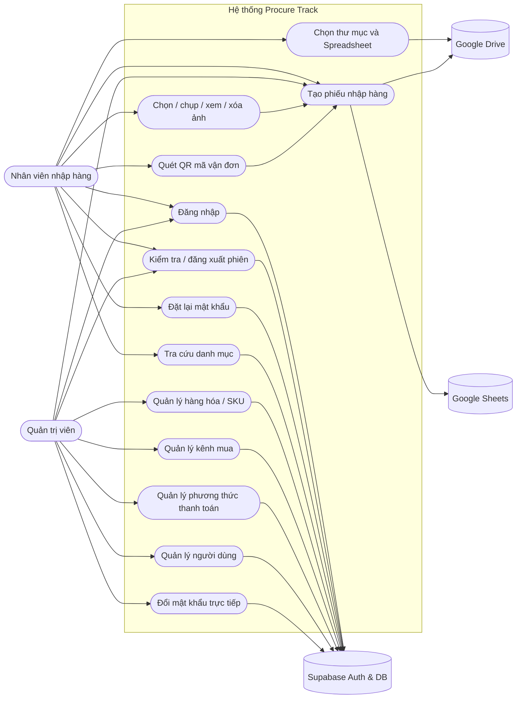
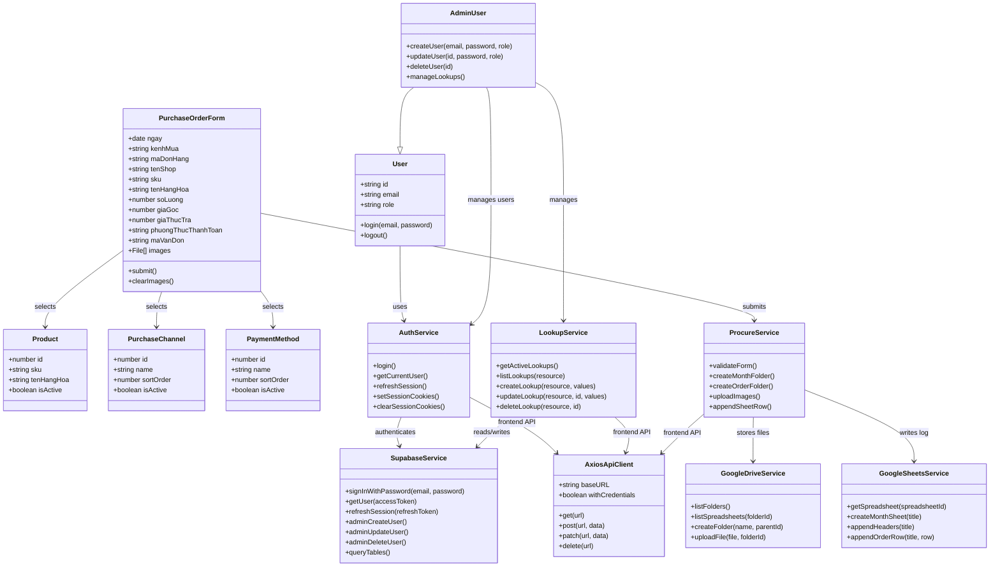

# Tài liệu đặc tả hệ thống Procure Track

## 1. Thông tin chung

**Tên hệ thống:** Procure Track

**Mục đích:** Ghi nhận đơn hàng nhập vào, lưu chứng từ lên Google Drive và ghi nhật ký đơn hàng vào Google Sheets. Giúp người bán hàng dễ dàng lưu trữ các đơn nhập hàng của họ

**Đối tượng sử dụng:**

- Nhân viên nhập hàng (`staff`).
- Quản trị viên (`admin`).

**Trạng thái tài liệu:** Đặc tả theo mã nguồn hiện tại.

## 2. Kiến trúc tổng thể

Hệ thống gồm hai ứng dụng:

| Thành phần | Công nghệ | Cổng mặc định | Vai trò |
|---|---|---:|---|
| Frontend | React, Vite, React Router, Tailwind CSS | `5173` | Giao diện người dùng |
| Backend | Next.js App Router | `3000` | API, xác thực, Supabase, Google Drive/Sheets |
| Cơ sở dữ liệu/Auth | Supabase | - | Người dùng và danh mục |
| Lưu trữ chứng từ | Google Drive | - | Thư mục tháng, thư mục đơn hàng, ảnh |
| Nhật ký | Google Sheets | - | Ghi từng đơn hàng theo tab tháng |

Frontend giao tiếp với backend qua Axios instance dùng chung tại:

```text
apps/src/services/api.js
```

Instance này cấu hình `baseURL`, timeout 30 giây, `withCredentials: true` và interceptor xử lý phiên hết hạn.

## 3. Cấu trúc thư mục chính

```text
apps/
  src/
    App.jsx
    components/
      HomeDashboard.jsx
      Layout.jsx
      Login.jsx
      LookupManager.jsx
    pages/
      UsersPage.jsx
      ResetPassword.jsx
      lookupConfigs.js
    services/
      api.js
      supabase.js

services/
  app/api/
    auth/
    admin/
    drive/
    lookups/
    procure/
  lib/
    auth.js
    supabase.js
    admin-users.js
    admin-lookups.js
```

## 4. Phân quyền

### 4.1. Vai trò

Vai trò ứng dụng được lưu trong Supabase `app_metadata`:

```json
{
  "role": "admin"
}
```

Các giá trị hợp lệ:

- `admin`: quản lý danh mục và người dùng.
- `staff`: nhập hàng; đây là vai trò mặc định nếu không có `app_metadata.role = "admin"`.

Không đặt role trong `user_metadata` vì backend không đọc trường đó.

### 4.2. Cơ chế phiên

Sau khi đăng nhập thành công, backend lưu phiên Supabase vào cookie HTTP-only:

- `pt-access-token`
- `pt-refresh-token`

Cookie có `path=/`; local dùng `sameSite=lax`, còn production dùng `sameSite=none` và `secure=true` để hỗ trợ frontend Cloudflare Pages gọi backend Cloudflare Worker khác origin.

Frontend không tự đọc access token. Mỗi lần tải ứng dụng, frontend gọi `GET /api/auth/me` để xác định user hiện tại.

### 4.3. Kết nối Google OAuth

Admin có thể vào **Quản trị → Kết nối Google** để cấp quyền Drive và Sheets bằng OAuth.

- Callback: `/api/admin/google/callback`.
- Scope Drive: `https://www.googleapis.com/auth/drive`.
- Scope Sheets: `https://www.googleapis.com/auth/spreadsheets`.
- Refresh token được mã hóa AES-256-GCM trước khi lưu vào `google_oauth_connections`.
- Frontend không nhận, lưu hoặc hiển thị refresh token/client secret.
- Nút ngắt kết nối đánh dấu connection bị disable và làm các API Google dừng sử dụng token đó.

## 5. Chức năng frontend

### 5.1. Đăng nhập

Màn hình đăng nhập nhận:

- Email.
- Mật khẩu.
- Nút hiện/ẩn mật khẩu.

Request:

```http
POST /api/auth/login
Content-Type: application/json

{
  "email": "user@example.com",
  "password": "..."
}
```

### 5.2. Đặt lại mật khẩu

Route:

```text
/reset-password
```

Frontend nhận recovery session từ URL hash của Supabase, gọi `supabase.auth.updateUser({ password })`, sau đó đăng nhập lại qua backend để tạo cookie HTTP-only.

Nếu Supabase redirect về `/` nhưng URL có `type=recovery` hoặc `access_token`, ứng dụng vẫn nhận diện và mở giao diện đặt lại mật khẩu.

### 5.3. Nhập hàng

Form nhập hàng gồm:

| Trường | Kiểu | Bắt buộc | Mô tả |
|---|---|---:|---|
| Ngày nhập | Date | Có | Định dạng `YYYY-MM-DD` |
| Kênh mua | Radio | Có | Lấy từ danh mục `purchase_channels` |
| Mã đơn hàng | Text | Có | Mã đơn từ nhà cung cấp/sàn |
| Tên shop | Text | Có | Nhà cung cấp hoặc shop |
| SKU | Text + datalist | Có | Có autocomplete/filter |
| Tên hàng hóa | Select | Có | Tự điền khi SKU khớp |
| Số lượng | Number | Có | Số lượng nhập |
| Phương thức thanh toán | Radio | Có | Lấy từ `payment_methods` |
| Giá gốc | Số nghìn | Có | Nhập `100` được hiểu là `100.000 VNĐ` |
| Giá thực trả | Số nghìn | Có | Nhập `120` được hiểu là `120.000 VNĐ` |
| Mã vận đơn | Text | Có | Có nút quét QR |
| Ảnh chứng từ | Nhiều file | Không | Có upload file và chụp camera |

Giá tiền hiển thị hậu tố `.000`. Ví dụ:

```text
100       => 100.000 VNĐ
1.000     => 1.000.000 VNĐ
```

Frontend gửi giá đầy đủ cho backend bằng cách nhân giá trị nhập với `1000`.

### 5.4. Ảnh chứng từ

Hệ thống hỗ trợ:

- Chọn nhiều ảnh bằng file picker.
- Mở camera và chụp nhiều ảnh.
- Hiển thị thumbnail ảnh đã chọn/chụp.
- Bấm thumbnail để xem ảnh lớn.
- Xóa từng ảnh bằng nút `×`.
- Xóa toàn bộ ảnh bằng nút **Xóa ảnh đã chọn**.

### 5.5. Quét mã QR

Nút **Quét QR** nằm cạnh ô mã vận đơn.

- Sử dụng thư viện `html5-qrcode`.
- Mở camera sau khi người dùng cấp quyền.
- Khi đọc được QR, nội dung được tự động điền vào mã vận đơn.
- Scanner dừng và modal đóng sau khi đọc thành công.

Camera yêu cầu `localhost` hoặc HTTPS.

### 5.6. Chọn Google Drive và Spreadsheet

Form tải danh sách folder và Spreadsheet từ backend.

Folder mặc định lấy từ `GOOGLE_PARENT_FOLDER_ID`.

Spreadsheet mặc định lấy từ `GOOGLE_SPREADSHEET_ID` nếu file đó nằm trong folder đang chọn.

Người dùng vẫn có thể chọn folder hoặc Spreadsheet khác nếu được trả về từ Google Drive.

### 5.7. Viewer nhật ký trên homepage

Homepage có viewer chỉ đọc cho tab tháng tương ứng với ngày nhập đang chọn. Viewer lấy dữ liệu qua backend Google Sheets API, không nhúng iframe và không yêu cầu publish Sheet ra internet.

- Tự tải lại khi đổi ngày hoặc Spreadsheet.
- Có nút làm mới thủ công.
- Lần đầu tải tối đa 5 dòng mới nhất; nút **Tải thêm 5 dòng** dùng để lazy load các dòng tiếp theo.
- Hiển thị header và các dòng dữ liệu trong vùng cuộn.
- Chỉ user đã đăng nhập mới gọi được viewer.

## 6. Luồng xử lý tạo đơn hàng

1. Người dùng điền form và chọn folder/Spreadsheet.
2. Frontend tạo `FormData`.
3. Ảnh được gửi với field lặp lại tên `images`.
4. Backend xác thực cookie.
5. Backend xác thực ngày, ID Drive và Spreadsheet.
6. Backend tìm hoặc tạo folder tháng:

```text
Tháng {month}/{year}
```

7. Backend tạo folder đơn hàng:

```text
{ngay}.{maDonHang}.{maVanDon}
```

8. Backend upload toàn bộ ảnh vào folder đơn hàng.
9. Backend tìm tab tháng trong Spreadsheet; nếu chưa có thì tạo tab và header.
10. Backend append một dòng nhật ký vào Google Sheets.
11. Backend trả về link folder chứng từ.

Header Google Sheets hiện tại:

```text
Ngày | Kênh mua | Mã đơn hàng | Tên Shop | SKU | Hàng hóa |
Số lượng | Giá gốc | Giá thực trả | Thanh toán | Vận đơn | Chứng từ
```

Backend có xử lý chống formula injection cho chuỗi bắt đầu bằng `=`, `+`, `-`, `@` hoặc ký tự điều khiển trước khi ghi vào Sheets.

## 7. API backend

Base URL frontend mặc định:

```text
http://localhost:3000/api
```

### 7.1. Auth

| Method | Endpoint | Quyền | Mục đích |
|---|---|---|---|
| `POST` | `/api/auth/login` | Public | Đăng nhập email/password |
| `GET` | `/api/auth/me` | User | Lấy user hiện tại |
| `POST` | `/api/auth/logout` | User | Xóa phiên |

### 7.2. Danh mục dùng cho form

| Method | Endpoint | Quyền | Mục đích |
|---|---|---|---|
| `GET` | `/api/lookups` | User | Lấy sản phẩm, kênh mua, phương thức thanh toán đang active |

### 7.3. Google Drive

| Method | Endpoint | Quyền | Mục đích |
|---|---|---|---|
| `GET` | `/api/drive/folders` | User | Lấy danh sách folder và cấu hình mặc định |
| `GET` | `/api/drive/spreadsheets?folderId=...` | User | Lấy Spreadsheet trong folder |
| `GET` | `/api/drive/sheet-data?spreadsheetId=...&sheetTitle=...` | User | Đọc dữ liệu tab tháng để hiển thị viewer |

### 7.4. Nhập hàng

| Method | Endpoint | Quyền | Content-Type |
|---|---|---|---|
| `POST` | `/api/procure` | User | `multipart/form-data` |

### 7.5. Quản trị người dùng

| Method | Endpoint | Quyền | Mục đích |
|---|---|---|---|
| `GET` | `/api/admin/users` | Admin | Danh sách user |
| `POST` | `/api/admin/users` | Admin | Tạo user với password và role |
| `PATCH` | `/api/admin/users/:id` | Admin | Đổi role/password |
| `DELETE` | `/api/admin/users/:id` | Admin | Xóa user |

### 7.7. Quản lý kết nối Google

| Method | Endpoint | Quyền | Mục đích |
|---|---|---|---|
| `GET` | `/api/admin/google/connect` | Admin | Tạo URL OAuth Google |
| `GET` | `/api/admin/google/callback` | Admin session | Nhận callback và lưu token mã hóa |
| `GET` | `/api/admin/google/status` | Admin | Kiểm tra kết nối và quyền Drive/Sheets |
| `POST` | `/api/admin/google/disconnect` | Admin | Disable kết nối Google |

User tạo từ màn hình quản trị được `email_confirm: true`, nên có thể đăng nhập ngay.

### 7.6. Quản trị danh mục

Resource hợp lệ:

- `products`
- `purchase-channels`
- `payment-methods`

| Method | Endpoint | Quyền | Mục đích |
|---|---|---|---|
| `GET` | `/api/admin/lookups/:resource` | Admin | Lấy cả bản ghi active/inactive |
| `POST` | `/api/admin/lookups/:resource` | Admin | Thêm bản ghi |
| `PATCH` | `/api/admin/lookups/:resource/:id` | Admin | Cập nhật bản ghi |
| `DELETE` | `/api/admin/lookups/:resource/:id` | Admin | Xóa bản ghi |

## 8. Dữ liệu Supabase

Các bảng được backend sử dụng:

### `products`

| Cột | Kiểu logic | Mô tả |
|---|---|---|
| `id` | Integer | Khóa chính |
| `sku` | Text | Mã SKU, unique |
| `ten_hang_hoa` | Text | Tên hàng hóa |
| `is_active` | Boolean | Có hiển thị trong form hay không |

### `purchase_channels`

| Cột | Mô tả |
|---|---|
| `id` | Khóa chính |
| `name` | Tên kênh mua |
| `sort_order` | Thứ tự hiển thị |
| `is_active` | Trạng thái sử dụng |

### `payment_methods`

Cấu trúc tương tự `purchase_channels`.

RLS được áp dụng khi truy vấn danh mục bằng user client. Các thao tác quản trị dùng Supabase secret key ở backend sau khi đã kiểm tra role admin.

## 9. Biến môi trường

### Backend `services/.env.local`

```env
SUPABASE_URL=
SUPABASE_PUBLISHABLE_KEY=
SUPABASE_SECRET_KEY=

GOOGLE_CLIENT_ID=
GOOGLE_CLIENT_SECRET=
GOOGLE_REDIRECT_URI=
GOOGLE_REFRESH_TOKEN=
GOOGLE_TOKEN_ENCRYPTION_KEY=
GOOGLE_PARENT_FOLDER_ID=
GOOGLE_SPREADSHEET_ID=

FRONTEND_ORIGIN=
```

Google Cloud OAuth Client phải khai báo redirect URI chính xác:

```text
http://localhost:3000/api/admin/google/callback
```

Production phải dùng callback URL HTTPS tương ứng. `GOOGLE_TOKEN_ENCRYPTION_KEY` là secret server-only dùng để mã hóa refresh token.

### Frontend `apps/.env`

```env
VITE_API_BASE_URL=http://localhost:3000/api
VITE_SUPABASE_URL=
VITE_SUPABASE_PUBLISHABLE_KEY=
```

Không đưa `SUPABASE_SECRET_KEY`, Google client secret hoặc refresh token vào frontend.

`SUPABASE_URL` phải là URL gốc của project, ví dụ:

```text
https://<project-ref>.supabase.co
```

Không thêm `/rest/v1/` vào `SUPABASE_URL`.

## 10. Khởi chạy môi trường phát triển

### Backend

```bash
cd services
npm install
npm run dev
```

Backend chạy mặc định tại `http://localhost:3000`.

### Frontend

```bash
cd apps
npm install
npm run dev
```

Frontend chạy mặc định tại `http://localhost:5173`.

Sau khi thay đổi `.env`, cần restart tiến trình tương ứng.

## 11. URL cấu hình Supabase Auth

Để test recovery password trên local, cấu hình trong Supabase:

```text
Site URL: http://localhost:5173
Redirect URL: http://localhost:5173/reset-password
```

Nếu email recovery redirect về `/`, frontend vẫn nhận diện URL hash recovery; tuy nhiên nên dùng redirect URL `/reset-password` để rõ ràng.

## 12. Quy tắc bảo mật và vận hành

- Không commit file `.env.local` hoặc secret key.
- Chỉ backend được dùng `SUPABASE_SECRET_KEY`.
- Chỉ backend được dùng Google refresh token.
- Các endpoint admin luôn gọi `requireAdmin()`.
- Không tin cậy role gửi từ frontend; role được đọc từ Supabase `app_metadata`.
- Xác thực và giới hạn format ID Google Drive/Spreadsheet trước khi đưa vào query.
- Escape chuỗi có khả năng trở thành công thức Google Sheets.
- Email recovery của Supabase có rate limit; test nội bộ nên đổi password trực tiếp từ màn hình quản trị.
- Camera hoạt động tốt nhất trên HTTPS hoặc `localhost`.

## 13. Các giới hạn hiện tại

- Chưa có schema migration trong repository; bảng Supabase phải được tạo/cấu hình ngoài mã nguồn.
- Chưa có test tự động cho frontend/backend.
- Danh sách folder và Spreadsheet phụ thuộc quyền của Google refresh token.
- Email recovery phụ thuộc email provider/rate limit của Supabase.
- QR scanner phụ thuộc quyền camera và khả năng truy cập camera của trình duyệt.
- Upload ảnh được thực hiện trong cùng request tạo đơn; file lớn có thể làm request lâu.

## 14. Quy ước phát triển tiếp theo

Mọi giao tiếp từ frontend tới backend phải dùng Axios instance có sẵn:

```js
import api from '../services/api';

await api.get('/endpoint');
await api.post('/endpoint', payload);
await api.patch('/endpoint/:id', payload);
await api.delete('/endpoint/:id');
```

Không dùng trực tiếp `fetch`, `XMLHttpRequest` hoặc tạo Axios instance mới trong component. Trường hợp đặc biệt `supabase.auth` trong recovery flow là SDK trực tiếp của Supabase để xử lý recovery session, không thay thế API backend thông thường.

## Phụ lục A. Sơ đồ Use Case

Sơ đồ dưới đây mô tả các tác nhân chính và các chức năng theo mã nguồn hiện tại.



### Mối quan hệ chính

- `Admin` có toàn bộ khả năng nhập hàng của `Staff` và thêm nhóm chức năng quản trị.
- `Đăng nhập`, `Kiểm tra phiên`, quản lý người dùng và danh mục sử dụng Supabase.
- Tạo phiếu nhập hàng sử dụng Google Drive để lưu thư mục/ảnh và Google Sheets để ghi nhật ký.
- Upload/chụp ảnh và quét QR là các chức năng hỗ trợ trong luồng tạo phiếu nhập hàng.

## Phụ lục B. Sơ đồ lớp

Sơ đồ lớp dưới đây mô tả các lớp/đối tượng chính trong frontend, backend và các dịch vụ tích hợp. Đây là mô hình logic rút gọn theo mã nguồn, không phải sơ đồ class vật lý của JavaScript runtime.



### Diễn giải quan hệ

- `AdminUser` kế thừa quyền cơ bản của `User` và có thêm chức năng quản trị.
- `PurchaseOrderForm` tham chiếu đến ba danh mục `Product`, `PurchaseChannel` và `PaymentMethod`.
- `ProcureService` điều phối toàn bộ luồng tạo đơn: tạo thư mục, upload ảnh và ghi Sheets.
- `AuthService` và `LookupService` sử dụng `SupabaseService` ở backend.
- Frontend gọi backend thông qua `AxiosApiClient`, tương ứng với instance `api` trong `apps/src/services/api.js`.

## 15. Ghi nhận kỹ thuật triển khai Cloudflare (2026-11-17)

### 15.1. Mô hình host production

Hệ thống production được tách thành hai dịch vụ:

| Thành phần | Nền tảng | URL |
|---|---|---|
| Frontend | Cloudflare Pages | `https://procure-track.pages.dev` |
| Backend API | Cloudflare Workers (Vinext) | `https://procure-track-api.thuancao-mmo.workers.dev` |

Frontend gọi backend qua:

```text
https://procure-track-api.thuancao-mmo.workers.dev/api
```

Mã nguồn production dùng nhánh `main`. Nhánh `deploy/cloudflare` là nhánh triển khai trước đây; sau khi kiểm tra ổn định, cấu hình production được chuyển về `main`.

### 15.2. Cloudflare Worker

Backend được build và deploy bằng Vinext:

```bash
cd services
npm run build:vinext
npm run deploy:vinext
```

Cấu hình nằm tại `services/cloudflare.config.ts`:

- Worker name: `procure-track-api`.
- Entrypoint: `vinext/server/fetch-handler`.
- Frontend origin production: `https://procure-track.pages.dev`.
- Không dùng Cloudflare R2 hoặc Response Store vì không muốn yêu cầu thẻ thanh toán.
- Secret runtime được cấu hình riêng trên Cloudflare Worker, không đưa vào frontend hoặc Git.

### 15.3. CORS và cookie production

Backend cho phép frontend production gọi API cross-origin bằng cookie phiên:

```text
Access-Control-Allow-Origin: https://procure-track.pages.dev
Access-Control-Allow-Credentials: true
```

Cookie xác thực gồm `pt-access-token` và `pt-refresh-token`. Production dùng `Secure` và `SameSite=None`; local dùng origin `http://localhost:5173`.

Mã lỗi được phân biệt như sau:

```text
401: chưa đăng nhập hoặc cookie phiên không hợp lệ.
403: Google token/API không đủ quyền.
500: lỗi thực thi backend, cần đọc log Worker để tìm nguyên nhân.
```

### 15.4. Google OAuth và Google API

Admin kết nối Google từ màn hình quản trị. Backend nhận callback OAuth, mã hóa refresh token bằng AES-256-GCM rồi lưu vào bảng `google_oauth_connections` trong Supabase.

Các biến chính:

```env
GOOGLE_CLIENT_ID=
GOOGLE_CLIENT_SECRET=
GOOGLE_REDIRECT_URI=
GOOGLE_REFRESH_TOKEN=
GOOGLE_TOKEN_ENCRYPTION_KEY=
GOOGLE_PARENT_FOLDER_ID=
GOOGLE_SPREADSHEET_ID=
```

`GOOGLE_PARENT_FOLDER_ID` là thư mục Drive mặc định và `GOOGLE_SPREADSHEET_ID` là Spreadsheet mặc định. Production ưu tiên OAuth connection đã lưu; local có thể dùng `GOOGLE_REFRESH_TOKEN` trong `services/.env.local` để test.

Đã xử lý tương thích Google API trên Cloudflare Workers:

- Clone header bằng `new Headers(...)` để không làm mất `Authorization`.
- Gửi `Accept-Encoding: identity` để tránh response gzip bị xử lý sai.
- Parse response JSON khi Google client trả body dạng chuỗi.
- Chuẩn hóa token trước khi gắn hoặc cập nhật `refresh_token`.

Lỗi `Method doesn't allow unregistered callers` trước đây do request bị mất header xác thực; không phải do phải bật lại Google Drive API.

### 15.5. Build và vận hành

Backend từng gặp lỗi PostCSS do cấu hình khiến Vite đọc `services/tailwindcss` như một file. Cấu hình PostCSS/Tailwind phải dùng plugin đã cài trong `node_modules`.

Khi kiểm tra hệ thống cần đọc đúng log của API/Worker, không coi mọi `401` là lỗi server. `401 /api/auth/me` khi chưa đăng nhập là trạng thái hợp lệ.

## 16. CI/CD bằng GitHub Actions

### 16.1. Workflow

Workflow nằm tại:

```text
.github/workflows/deploy-production.yml
```

Workflow chạy khi:

- Có commit hoặc merge PR vào `main`.
- Chạy thủ công bằng `workflow_dispatch`.

Luồng deploy:

```text
push/merge main
    ↓
Deploy backend Worker
    ↓
Build frontend
    ↓
Deploy frontend Cloudflare Pages
```

Frontend chỉ deploy sau khi backend thành công (`needs: deploy-backend`). Cả hai job dùng Node.js 22 và `npm ci` theo lockfile.

### 16.2. GitHub Environment và Secrets

Tạo environment:

```text
Repository → Settings → Environments → New environment → production
```

Thêm các Environment secrets:

```env
CLOUDFLARE_API_TOKEN=
CLOUDFLARE_ACCOUNT_ID=
VITE_API_BASE_URL=https://procure-track-api.thuancao-mmo.workers.dev/api
VITE_SUPABASE_URL=https://qlnnunnscxhlwyfppgiu.supabase.co
VITE_SUPABASE_PUBLISHABLE_KEY=
```

Cloudflare API token dùng cho pipeline chỉ cần các quyền:

```text
Account Settings: Read
Workers Scripts: Edit
Cloudflare Pages: Edit
```

Nên giới hạn token trong đúng Cloudflare account chứa Worker và Pages project. Không cấp DNS, Billing, R2, KV, Workers Routes hoặc User API Tokens nếu pipeline không sử dụng các dịch vụ đó.

`VITE_SUPABASE_PUBLISHABLE_KEY` chỉ được là publishable/anon public key. Không đưa `SUPABASE_SECRET_KEY`, service role key, Google client secret hoặc Google refresh token vào biến `VITE_`.

### 16.3. Các job deploy

Backend:

```yaml
working-directory: services
run: npm ci
run: npm run deploy:vinext
```

Frontend:

```yaml
working-directory: apps
run: npm ci
run: npm run build
command: pages deploy dist --project-name procure-track
```

Frontend nhận các biến `VITE_*` từ GitHub Secrets tại thời điểm build. Backend dùng `CLOUDFLARE_API_TOKEN` và `CLOUDFLARE_ACCOUNT_ID` để xác thực Wrangler.

### 16.4. Quy trình phát hành

```bash
git checkout main
git pull origin main
git add .
git commit -m "your change"
git push origin main
```

Sau khi push hoặc merge PR, kiểm tra GitHub → **Actions** → **Deploy production**. Nếu Cloudflare Pages vẫn bật Git integration tự động cho production branch, cần tắt cơ chế deploy trùng; workflow GitHub Actions là nguồn deploy chính.

## 17. Danh sách việc đã hoàn thành trong phiên triển khai

- Giữ frontend production trên Cloudflare Pages tại `procure-track.pages.dev`.
- Deploy backend Vinext lên Cloudflare Workers.
- Cấu hình CORS giữa Pages và Worker.
- Cấu hình cookie cross-origin cho phiên đăng nhập production.
- Kết nối và lưu Google OAuth token an toàn.
- Dùng folder Drive và Spreadsheet mặc định từ biến môi trường.
- Sửa xử lý response/token Google API trên Cloudflare Workers.
- Bỏ phụ thuộc R2/Response Store để không yêu cầu thẻ thanh toán.
- Chuyển nguồn deploy production về nhánh `main`.
- Tạo GitHub Actions tự động deploy backend rồi frontend sau mỗi lần merge/push vào `main`.
- Bổ sung chạy workflow thủ công bằng `workflow_dispatch`.
- Tách secret CI/CD vào GitHub Environment `production`.
